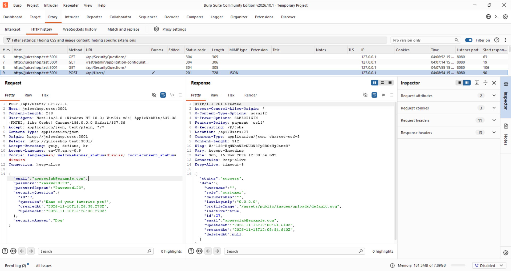
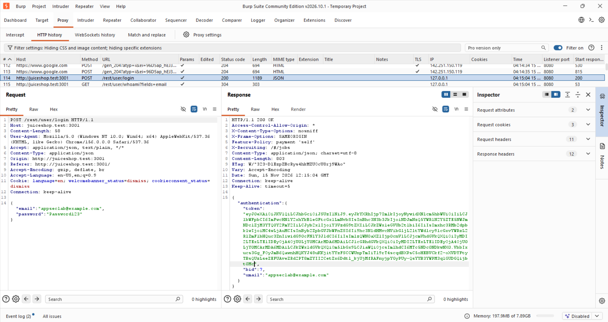
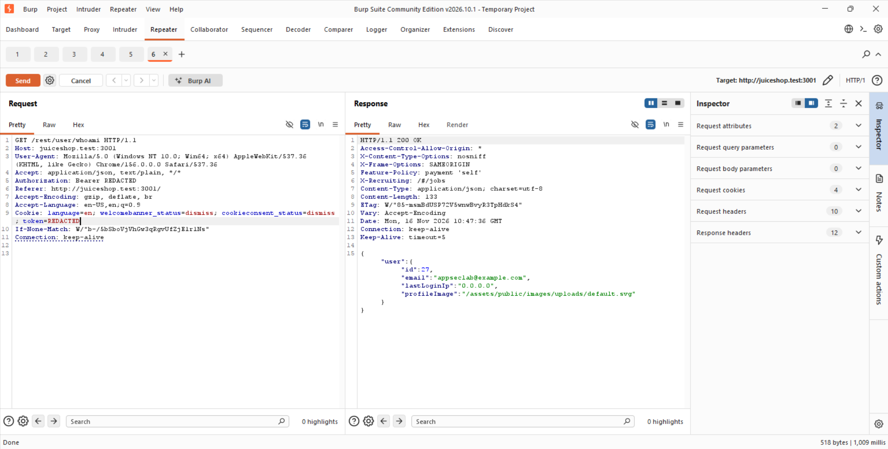
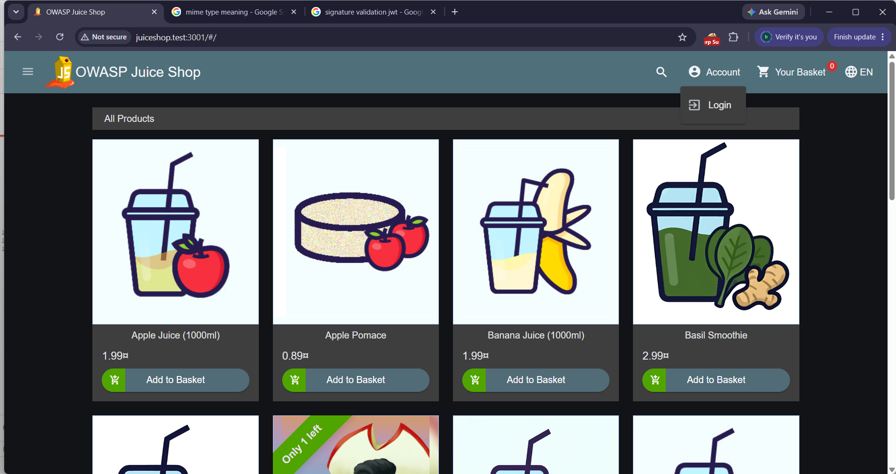

# 🔐 Authentication & Session Analysis

> Practical Application Security lab using **OWASP Juice Shop, Burp Suite, Docker, and WSL2**.

This lab investigates how a web application handles **authentication, JWTs, session state, authentication transport, and logout behavior**.

Rather than only completing predefined challenges, I used Burp Suite to capture, replay, and modify authentication-related HTTP requests to understand what the server actually trusts.

---

## 🎯 Objectives

- Understand the authentication flow of a web application.
- Capture and analyze registration and login requests.
- Inspect JWT structure and claims.
- Identify how authentication credentials are transported.
- Test whether authentication depends on cookies or headers.
- Understand the difference between authentication and authorization.
- Investigate whether previously issued tokens remain valid after logout.
- Document security observations based on actual request/response evidence.

---

## 🧪 Lab Environment

| Component | Details |
|---|---|
| Application | OWASP Juice Shop |
| Proxy | Burp Suite |
| Browser | Google Chrome |
| Platform | Windows 11 + WSL2 |
| Runtime | Docker |
| Lab Host | `juiceshop.test:3001` |
| Testing Method | HTTP request interception, modification & replay |

### Lab Architecture

```text
Chrome
   │
   │ HTTP
   ▼
Burp Suite
   │
   │ Proxy
   ▼
Juice Shop
   │
   ▼
Docker / WSL2
```

I configured a local lab hostname:

```text
juiceshop.test → 127.0.0.1
```

This allowed the browser traffic to pass through Burp Suite while still reaching the locally running Juice Shop instance.

---

# 🔎 Investigation Flow

```text
Registration
     ↓
Login
     ↓
JWT Issuance
     ↓
JWT Analysis
     ↓
Authenticated Request
     ↓
Authentication Transport Testing
     ↓
Logout
     ↓
Previously Issued Token Replay
```

---

# 1. 📝 Registration

I first created a dedicated test account through the Juice Shop registration endpoint.

### Request

```http
POST /api/Users/ HTTP/1.1
Host: juiceshop.test:3001
Content-Type: application/json
```

The request contained the user's registration information, including:

```json
{
  "email": "appseclab@example.com",
  "password": "********",
  "passwordRepeat": "********"
}
```

### Response

The server returned:

```http
HTTP/1.1 201 Created
Location: /api/Users/27
```

The response also showed that the server assigned the account the role:

```json
"role": "customer"
```

### Observation

The client did not explicitly submit the account's role.

This is a useful reminder that **security-sensitive properties such as roles should be determined and enforced server-side**, rather than trusted from client-controlled input.



---

# 2. 🔑 Login & JWT Issuance

After registration, I authenticated using the newly created account.

### Request

```http
POST /rest/user/login HTTP/1.1
Host: juiceshop.test:3001
Content-Type: application/json
```

Request body:

```json
{
  "email": "appseclab@example.com",
  "password": "********"
}
```

### Response

The application returned:

```http
HTTP/1.1 200 OK
```

with an authentication token:

```json
{
  "authentication": {
    "token": "[REDACTED]",
    "bid": 7,
    "umail": "appseclab@example.com"
  }
}
```



> **Security note:** JWTs and credentials were redacted from the screenshots and documentation.

---

# 3. 🧩 JWT Analysis

I decoded the JWT locally to inspect its structure.

The token used:

```json
{
  "typ": "JWT",
  "alg": "RS256"
}
```

The payload contained identity and session-related claims including:

```text
id
email
role
bid
iat
```

### Important observations

- The token uses **RS256**.
- The token contains user identity information.
- The `role` claim is present inside the token.
- `iat` represents the token's **Issued At** timestamp.
- I did not observe an `exp` (Expiration Time) claim in the tested token.

### Important distinction

Decoding a JWT does **not** prove that the token is trustworthy.

JWT contents are encoded, not encrypted. The security of the token depends on the server correctly validating its signature and claims.

---

# 4. 🔐 Authenticated Request

After logging in, I captured an authenticated request to:

```http
GET /rest/user/whoami HTTP/1.1
Host: juiceshop.test:3001
```

The request contained the JWT through the `Authorization` header:

```http
Authorization: Bearer [REDACTED]
```

It also contained the token through a cookie:

```http
Cookie: ... token=[REDACTED]
```

The server returned:

```http
HTTP/1.1 200 OK
```

and identified the authenticated user:

```json
{
  "user": {
    "id": 27,
    "email": "appseclab@example.com",
    "lastLoginIp": "0.0.0.0",
    "profileImage": "/assets/public/images/uploads/default.svg"
  }
}
```



### Observation

The same authentication credential was being transported through **two channels**:

```text
Authorization: Bearer <JWT>

Cookie: token=<JWT>
```

This made the endpoint useful for testing which credential source the server actually relied upon.

---

# 5. 🧪 Authentication Transport Experiments

I modified the authenticated request in Burp Repeater and tested the credential sources independently.

## Experiment A — Cookie Only

I removed:

```http
Authorization: Bearer [REDACTED]
```

while leaving the authentication cookie intact.

### Result

```http
HTTP/1.1 200 OK
```

The response still identified the authenticated user.

### Conclusion

Under the tested conditions, the **token cookie alone was sufficient** for this endpoint to identify the user.

---

## Experiment B — Authorization Header Only

Next, I removed the authentication cookie while keeping:

```http
Authorization: Bearer [REDACTED]
```

The first response returned:

```http
304 Not Modified
```

This initially looked unusual.

However, the request contained an `If-None-Match` header, so I removed the cache validation condition and repeated the request.

The response then returned:

```http
HTTP/1.1 200 OK
```

with:

```json
{
  "user": {}
}
```

### Conclusion

Under the tested conditions, the `Authorization` header alone did **not** result in the endpoint identifying the user.

This was an important distinction because the HTTP status remained `200 OK`.

---

## Experiment C — No Authentication Credentials

Finally, I removed both:

```http
Authorization
```

and:

```text
token cookie
```

The response was:

```http
HTTP/1.1 200 OK
```

with:

```json
{
  "user": {}
}
```

### Observation

The endpoint does not necessarily use a `401 Unauthorized` response when no authenticated user is present.

This reinforced an important testing principle:

> **An HTTP status code alone is not enough to determine whether authentication succeeded.**

The response body and application behavior must also be examined.



---

# 6. 🚪 Logout & Previously Issued Token Replay

After logging out normally through the application, I tested whether a previously issued JWT could still be replayed.

Using Burp Repeater, I replayed a request containing the previously issued authentication token.

### Result

The application continued to return a successful response using the previously issued token.

### Observation

Under the tested conditions, the previously issued JWT remained accepted after browser logout.

This suggests that logout primarily clears the client's authentication state rather than immediately revoking the already-issued JWT.

### Why this matters

If a token is stolen before logout, simply logging out from the browser may not necessarily invalidate that token.

The practical security impact depends on factors such as:

- Token lifetime.
- Whether tokens have expiration.
- Server-side revocation mechanisms.
- Whether a stolen token can access sensitive resources.
- How long an attacker could reuse the token.

> **Important:** This observation alone does not establish a critical vulnerability. It demonstrates token persistence after logout and warrants further investigation of token lifetime and revocation behavior.

---

# 📊 Authentication Test Summary

| Test | Result | Observation |
|---|---|---|
| Normal authenticated request | `200 OK` | User identified |
| Cookie only | `200 OK` | User identified |
| Authorization header only | `200 OK` | User not identified |
| No credentials | `200 OK` | User not identified |
| Logout → replay old JWT | `200 OK` | Previously issued token remained accepted |

---

# 🧠 Key Lessons

### 1. Authentication ≠ Authorization

Authentication answers:

> **Who are you?**

Authorization answers:

> **What are you allowed to access or do?**

This lab focused primarily on authentication. The next stage is testing whether authenticated users can access resources belonging to other users.

---

### 2. Request Manipulation Is Not Automatically a Vulnerability

Changing a request and receiving a different response does not automatically mean a vulnerability exists.

The important question is:

```text
Can an attacker cross a security boundary they should not be able to cross?
```

That requires testing both the application's behavior and its intended security model.

---

### 3. HTTP Status Codes Need Context

A `200 OK` response does not necessarily mean authentication succeeded.

For example:

```http
HTTP/1.1 200 OK
```

was returned even when the endpoint responded with:

```json
{
  "user": {}
}
```

The response body and application state provided the actual context.

---

### 4. Caching Can Affect Security Testing

During the Authorization-header experiment, the server initially returned:

```http
304 Not Modified
```

because the request contained an `If-None-Match` cache validator.

Removing the cache condition allowed the authentication behavior to be observed directly.

This reinforced the importance of understanding **HTTP behavior**, not just security-specific headers.

---

### 5. JWTs Should Be Treated as Credentials

A JWT should be treated like a credential.

During testing:

- Tokens were never published.
- JWT values were redacted from screenshots.
- Passwords were redacted.
- Replayed tokens were used only against the local lab.

---

# 🔬 Security Takeaways

This investigation gave me practical experience with:

- HTTP request/response analysis.
- Authentication flows.
- JWT structure and claims.
- Bearer authentication.
- Authentication cookies.
- Burp Suite Proxy.
- Burp Repeater.
- HTTP caching behavior.
- Token replay.
- Logout/session behavior.
- Distinguishing observations from confirmed vulnerabilities.

More importantly, the lab reinforced a methodology I want to carry into real application security testing:

```text
Observe
   ↓
Form a hypothesis
   ↓
Modify one variable
   ↓
Replay the request
   ↓
Compare responses
   ↓
Determine security impact
   ↓
Document evidence
```

---

# ➡️ Next Lab: Authorization & IDOR/BOLA

The next investigation will move from:

```text
"Who am I?"
```

to:

```text
"What am I allowed to access?"
```

I will investigate how the application enforces **authorization and resource ownership**, including:

- Object identifiers.
- User-owned resources.
- IDOR.
- BOLA.
- Horizontal privilege escalation.
- Server-side authorization checks.

The goal is to determine whether an authenticated user can access another user's resources simply by manipulating an identifier.

---

## 🛡️ Responsible Testing

This lab was performed against a **locally hosted OWASP Juice Shop instance** that I was authorized to test.

No third-party or production systems were targeted.

---

## 📁 Repository Structure

```text
web-authentication-security-labs/
│
├── README.md
│
├── notes/
│   └── observations.md
│
└── screenshots/
    ├── registration.png
    ├── login-jwt.png
    ├── authenticated-request.png
    └── authentication-experiment.png
```